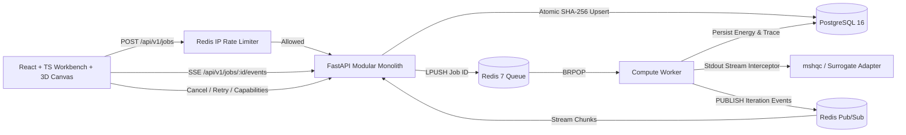

# mshqc-workbench

[](https://github.com/syahrulhidayat/mshqc-workbench/actions/workflows/ci.yml)
[](https://github.com/syahrulhidayat/mshqc-workbench/actions/workflows/cd.yml)

A full-stack asynchronous compute and visualization workbench for running electronic-structure
calculations (`mshqc`), streaming live iteration logs via Server-Sent Events (SSE), enforcing
per-IP Redis rate limits, and eliminating redundant compute through content-addressed SHA-256
deduplication in PostgreSQL.

## Visual Demo

> **Demo Clip (`docs/demo.gif`)** — Record a 12-second clip following this 4-shot storyboard:
> 1. **0-3s:** Select `H2O` preset, rotate the interactive 3D Canvas molecule preview, and run `RHF / cc-pVDZ`.
> 2. **3-7s:** Show live SSE iteration telemetry and the SVG energy convergence curve updating in real time.
> 3. **7-10s:** Resubmit the same geometry with padded decimals (`0.0` -> `0.0000`) to show an instant `CACHE HIT`.
> 4. **10-12s:** Demonstrate job lifecycle controls (`Cancel` / `Retry`) and persisted history inspection.

## Architecture



## Quickstart (One Command)

```bash
git clone https://github.com/syahrulhidayat/mshqc-workbench.git
cd mshqc-workbench
cp .env.example .env
make dev
```

To build the worker image with the real `mshqc` PyPI wheel enabled:

```bash
INSTALL_MSHQC=true docker compose up --build
```

* **Frontend Workbench:** `http://localhost:5173`
* **Backend OpenAPI Docs:** `http://localhost:8000/docs`
* **Capabilities Endpoint:** `http://localhost:8000/api/v1/capabilities`
* **Health Check:** `http://localhost:8000/healthz`

## Engineering Trade-offs

1. **Modular Monolith + Isolated Worker over Microservices:** Keeps API, domain validation,
   and worker sharing one canonical hashing and geometry module while isolating CPU-bound
   quantum chemistry compute from the FastAPI async event loop.
2. **Server-Sent Events (SSE) over WebSockets:** Iteration progress is strictly server-to-client.
   SSE works natively over HTTP, auto-reconnects via `EventSource`, and subscribes to Redis
   Pub/Sub before re-reading DB state to prevent missed terminal events.
3. **Content-Addressed SHA-256 Deduplication:** Coordinates are canonicalized (capitalized
   symbols, 8-decimal rounding, normalized method/basis) before hashing. Identical physical
   systems bypass the queue atomically via PostgreSQL `ON CONFLICT (input_hash)`.
4. **Raw Parameterized SQL (`psycopg_pool`) over Heavy ORM:** With one core aggregate
   (`compute_jobs`), explicit SQL keeps upsert atomicity, status transition guards
   (`cancel`/`retry`), and query plans transparent.
5. **Native HTML5 Canvas 3D Viewer over Three.js:** Renders CPK atoms, covalent bonds, and
   pointer drag-rotation using painter's algorithm sorting in ~180 lines of TypeScript, keeping
   the production frontend bundle compact (~50 kB gzipped).

## Verification & Benchmarks

Run static checks, backend tests, and frontend typecheck/build:

```bash
make verify
```

Run the reproducible load and cache-hit benchmark locally against `make dev`, or trigger
`.github/workflows/benchmark.yml` directly from GitHub Actions:

```bash
make bench-update
```

<!-- BENCHMARK_START -->
| Workload Scenario | Requests | Concurrency | Cache Hits | Errors | Throughput (req/s) | p50 (ms) | p95 (ms) | p99 (ms) |
| :--- | :---: | :---: | :---: | :---: | :---: | :---: | :---: | :---: |
| Unique Jobs (Cache Miss + Enqueue) | 100 | 10 | TBD | TBD | TBD (run `make bench-update`) | TBD | TBD | TBD |
| Identical Canonical Geometry (SHA-256 Hit) | 100 | 10 | TBD | TBD | TBD (run `make bench-update`) | TBD | TBD | TBD |

*Hardware baseline: Run `make bench-update` or trigger the GitHub Actions Benchmark workflow to record measured metrics.*
<!-- BENCHMARK_END -->
