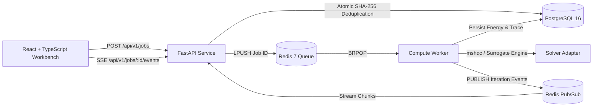

# mshqc-workbench

A full-stack asynchronous compute and visualization workbench for running electronic-structure
calculations (`mshqc`), streaming live iteration logs via Server-Sent Events (SSE), and
eliminating redundant compute through content-addressed SHA-256 caching in PostgreSQL.

## Visual Demo

> **Demo GIF Placeholder** — Record a 12-second clip following this 4-shot storyboard
> and save as `docs/demo.gif`:
> 1. **0-3s:** Select `H2O` preset (`RHF / cc-pVDZ`) and click **Run Calculation**.
> 2. **3-7s:** Show live SSE iteration logs and the SVG convergence curve updating in real time.
> 3. **7-10s:** Resubmit the same geometry with padded decimals (`0.0` -> `0.0000`) to trigger `CACHE HIT`.
> 4. **10-12s:** Click a persisted run in Recent Jobs to inspect stored energies and traces.

## Architecture



## Quickstart (One Command)

```bash
git clone https://github.com/syahrulhidayat/mshqc-workbench.git
cd mshqc-workbench
cp .env.example .env
make dev
```

* **Frontend Workbench:** `http://localhost:5173`
* **Backend OpenAPI Docs:** `http://localhost:8000/docs`
* **Health Check:** `http://localhost:8000/healthz`

## Engineering Trade-offs

1. **Modular Monolith + Isolated Worker over Microservices:** Keeps API, domain validation,
   and worker sharing one canonical hashing and geometry module while isolating CPU-bound
   compute from the HTTP event loop.
2. **Server-Sent Events (SSE) over WebSockets:** Iteration progress is strictly server-to-client.
   SSE uses native HTTP semantics, auto-reconnects via `EventSource`, and avoids stateful
   bidirectional framing overhead.
3. **Content-Addressed SHA-256 Caching:** Inputs are canonicalized (trimmed symbols, fixed
   8-decimal coordinate rounding, normalized method/basis) before hashing. Identical physical
   systems skip the queue atomically via PostgreSQL `ON CONFLICT (input_hash)`.
4. **Parameterized Raw SQL (`psycopg_pool`) over Heavy ORM:** The data model has a single core
   aggregate (`compute_jobs`). Direct SQL keeps query plans transparent and avoids N+1 overhead.

## Benchmarks & Verification

```bash
make test
make lint
make bench
```

| Workload Scenario | Concurrency | Throughput (req/s) | Latency p50 (ms) | Latency p95 (ms) | Latency p99 (ms) |
| :--- | :---: | :---: | :---: | :---: | :---: |
| Unique Jobs (Cache Miss + Enqueue) | 10 | TBD (run `make bench`) | TBD | TBD | TBD |
| Identical Canonical Geometry (Cache Hit) | 10 | TBD (run `make bench`) | TBD | TBD | TBD |

*Hardware baseline: Fill after running `make bench` on your machine.*
